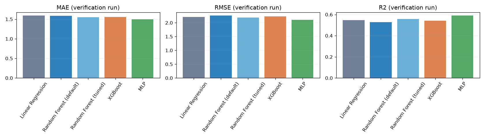
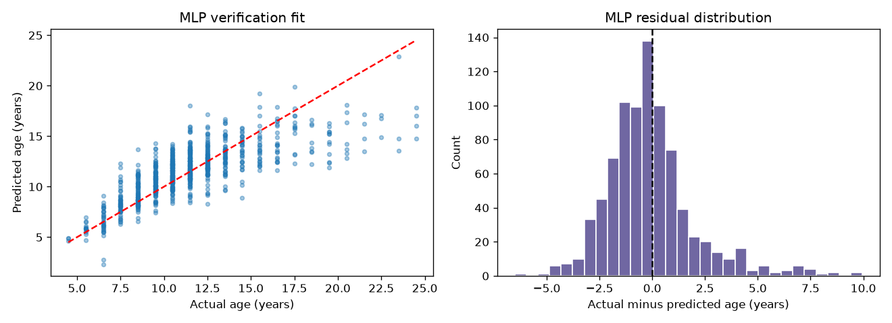
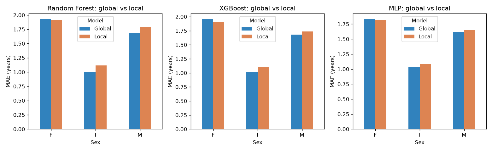

# Abalone Age Prediction — CSCI323 Modern Artificial Intelligence

Predict abalone age from physical measurements and Sex using **linear regression, Random Forest, XGBoost and a multilayer perceptron (MLP)**. The target is `Age = Rings + 1.5` years. This repository provides the report's experiment design, five readable notebooks, a complete runner, official data, reproducible splits, research references and measured verification outputs.

## Run the project

Use **Python 3.12** for the recorded verification environment. From this repository folder:

```bash
python -m venv .venv
# Windows PowerShell:
.venv\Scripts\Activate.ps1
# macOS / Linux: source .venv/bin/activate
python -m pip install -r requirements.txt
python run_all.py
```

The runner performs the original ten-candidate, five-fold Random Forest search on training rows, then evaluates every method on the same untouched test partition. For a quicker run with the archived best forest settings, use `python run_all.py --skip-search`; this does not rerun parameter selection. Runtime depends on the computer.

For interactive exploration, open the notebooks in Jupyter/VS Code with the same environment; install Jupyter separately if needed. Start with `preprocessing.ipynb`, followed by the model notebooks. Keep `abalone_project.py` and the CSV files in the notebook directory.

## Files

| File | Purpose |
|---|---|
| `preprocessing.ipynb` | Validate UCI data, encode Sex, split rows and fit train-only scaling |
| `linear_regression.ipynb` | Least-squares baseline and residual interpretation |
| `random_forest.ipynb` | Default forest, training-only CV tuning and subgroup comparison |
| `xgboost.ipynb` | Boosted-tree regression and global/local comparison |
| `MLP.ipynb` | Scaled-input neural-network regression and subgroup comparison |
| `abalone_project.py`, `run_all.py` | Shared implementation and full experiment runner |
| `abalone.data`, `abalone.names` | Official UCI data and original description |
| `X_*_raw.csv`, `X_*_scaled.csv`, `y_*.csv` | Recreated report-design splits; y files store Rings |
| `split_manifest.csv`, `data_audit.json` | Exact row membership, integrity hash and scaler audit |
| `report_metrics.csv` | Archived report numbers, retained as historical evidence |
| `verification_*.csv`, `verification_*.png` | Independently computed outputs from the recorded environment |
| `verification_environment.json`, `rf_cv_results.csv` | Actual settings, library versions, warnings and CV scores |
| `RESULTS.md`, `RESEARCH.md` | Score provenance, interpretation, limitations and DOI references |
| `THIRD_PARTY_NOTICES.md` | Dataset license, prior group work and assistance acknowledgement |

## Experimental design

- **4,177** records; eight original predictors; no missing values or duplicate rows. Two zero-height observations are retained and documented.
- All F/I/M indicator columns are kept: seven measurements + three indicators = **10 inputs**. Rings is excluded from predictors.
- An unstratified **80/20 split, seed 42**, gives **3,341 training / 836 test** records. All methods share it.
- StandardScaler is fitted on the seven numerical **training** columns only. Linear regression and MLP use the scaled files; forests and XGBoost use raw measurements.
- MAE/RMSE have units of years; MSE has units of years squared; higher R² is better. Hyperparameter variants do not count as distinct methods.

## Archived report comparison

| Method | MAE ↓ | MSE ↓ | R² ↑ |
|---|---:|---:|---:|
| Default Random Forest | 1.5827 | 5.1074 | 0.5282 |
| Tuned Random Forest | 1.5479 | 4.7970 | 0.5569 |
| XGBoost, original report snapshot | 1.5599 | 4.9603 | 0.5418 |
| **MLP** | **1.4999** | **4.4342** | **0.5904** |

These archived figures support favouring MLP **within the reported experiment**. They are not a promise that MLP wins every rerun or dataset. The public prior XGBoost notebook saved a different run (MAE 1.561547, MSE 4.987155, R² 0.539302); both sources are preserved separately. The original environment is unavailable. See [RESULTS.md](RESULTS.md) for the newly measured scores rather than treating historical screenshots as fresh output.

## Verification figures





## Research and limitations

The related abalone paper by Guney et al. (2022), [DOI 10.1007/978-3-031-04112-9_25](https://doi.org/10.1007/978-3-031-04112-9_25), studies three-class age prediction. It motivates relevant approaches; its classification accuracy is not directly comparable with this regression experiment. Method equations, connections and further references are in [RESEARCH.md](RESEARCH.md).

One held-out split gives limited evidence of generalization. Older abalones have fewer training examples; subgroup sample sizes differ. The original RF global/local experiment changes both data population and parameters, so it is exploratory. The verification age-bin definitions cover ages above 25 and mark empty intervals; this test split contains no observations above 25, so the extra bin does not change the measured errors. Appropriate future improvements include nested/repeated evaluation, uncertainty estimates and controlled subgroup comparisons; no unrun improvement is presented as a measured result.

## Acknowledgements

This continues the [earlier FT16 group experiment](https://github.com/tianyizhang789-star/CSCI323_Project_Group_FT16_Code), with a clean implementation of the documented design. See [THIRD_PARTY_NOTICES.md](THIRD_PARTY_NOTICES.md) for attribution, the UCI CC BY 4.0 data license and the assistance disclosure. The accompanying report remains a separate submission document.
